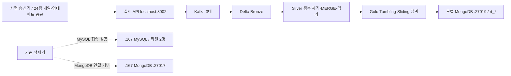

# NODEVERSE 실제 서비스 시험·보완 점검 (2026-11-20)

**판정: 로컬 v2 처리 경로 정상. 팀원 서버까지의 전체 연동은 미완료.**
실행 중인 Docker 서비스에 모의 게임 이벤트를 실제 HTTP로 전송했다.
최신 게임 EXE에서 발생시킨 로그나 다른 물리 PC의 게임 실행을 검증한 것은 아니다.
기존 8000/8010 서비스와 원격 데이터를 보존했고, v2 시험 프로젝트 nodeverse-v2-review만 시험했다.



## 실제 시험 결과

| 시험 | 결과 |
|---|---|
| 24종 미니게임 + 업데이트 9종 + 실행/종료 8종 | 고유 이벤트 255건 접수 100% |
| 동일 원문 전체 재전송 | 255건 다시 접수, Silver 원문 해시 유지·중복 없음 |
| 같은 ID에 변경 본문 | 해당 시험 이벤트 정확히 1건 id_conflict 격리 |
| 과거 7일·미래 6분·잘못된 필드·깨진 JSON | 422 및 DLQ 기록 확인 |
| 잘못된 X-API-Key | 401 확인 |
| 실행 이벤트 미래 6분 | 보완 후 실제 API에서 422 + schema_error + DLQ 확인 |
| 100 가상 사용자 / 50건·초 / 120초 | 6,000건 모두 202, 실측 50.0건·초 |
| API 응답 지연 | p50 16.3ms / p95 32.7ms / p99 41.6ms |
| 부하 후 최종 집계 반영 지연 3회 | 10.29초 / 9.12초 / 10.85초 |
| Kafka ↔ Bronze | 학습 8,189 / 실행 17 / 업데이트 19건 일치 |
| Silver 학습 | 7,848건 = 고유 ID 7,848개, 중복 0 |
| Silver 업데이트 | 10건 = 고유 ID 10개, 중복 0 |
| Gold ↔ Silver | 시도 1,192 / 성공 494 / 실패 566, 각 집계 일치 |
| MongoDB ↔ Gold | 집계·경고·업데이트·버전 4개 컬렉션 내용 차이 0, 불필요한 문서 0 |
| Kafka → Bronze lag | 0 |
| 단위 테스트 | 34건 통과, 외부 라이브러리 경고 1건 |

건수는 이전 시험 데이터가 남아 있는 누적값이다. 이번 신규 부하는 6,000건이며,
255건의 혼합 시험은 별도 원문/예상 ID·해시로 확인했다. 격리 누적값은 2건이다.
202는 Kafka 접수 확인이며 최종 저장은 별도 Spark 검증 작업으로 대조했다.
API 응답 시간과 최종 집계 반영 지연은 서로 다른 지표다.
지연 측정은 부하 종료 후 조용한 환경에서 수행했으며, 부하 중 15초 SLA를 증명하지 않는다.

## 시험 후 보완한 사항

1. simulator.py의 smoke/checks/updates/load가 실패를 출력하고도 성공 종료할 수 있던 문제 수정.
   실패 시 종료 코드 1을 반환한다.
2. 업데이트 재시험에서 같은 ID에 새로운 발생 시각을 붙이던 문제 수정.
   최초 생성 원문을 보관하고 그대로 재전송한다.
3. 실행/종료 이벤트에도 학습·업데이트와 동일한 5분 초과 미래 시각 검증 추가.
4. Collector와 MongoDB Docker healthcheck 추가. Spark는 MongoDB healthy 후 기동한다.
   probe와 E2E 송신기는 API ready를 기다려 시작한다.
5. 검증에서 Gold의 추가 문서를 놓치지 않도록 full outer 비교로 보완하고,
   MongoDB 비교를 1개 집계에서 경고/업데이트/버전까지 확장했다.
6. ID별 원문 해시, 정상 원문의 Bronze 2회 보존, Silver 내용 유지, 충돌 격리를 확인하는
   선택적 --expectations 검증을 추가했다.

7. 재기동 뒤 MERGE 원본 1차/2차 스캔의 행 수 차이 경고를 발견했다.
   `spark.databricks.delta.merge.materializeSource=none` 강제 설정을 제거하고 Delta 기본 자동
   원본 고정 기능을 복원했다. 기존 본문 해시/건수 대조에서는 데이터 차이가 없었다.
   설정 변경 후 새 이벤트 20건과 지연 측정 1건을 추가 전송하고 저장 대조도 통과했다.
   근거: https://docs.delta.io/delta-update/ (MERGE source determinism).

수집기 재기동 직후 처음 실행한 지연 측정은 준비 전 접속 거부로 실패했다.
이 기록은 results/e2e-latency-startup-error.txt에 보존했다. 준비 대기를 반영한 재측정은
3회 모두 15초 이내였다. 오류 기록을 삭제하거나 성공으로 바꾸지 않았다.

## 원격 서버 확인과 남은 작업

- .167 MySQL nodeverse 접속 성공, game_members 2명 확인. 이번 시험에서 원격 회원을 추가하지 않았다.
- .167 MongoDB 27017은 호스트/컨테이너에서 연결 거부. 인증 단계 이전 연결 문제다.
- v2는 로컬 rt_* 집계 저장 경로다. 기존 원격 회원·개별 플레이 기록 적재 경로와 분리되어 있다.
- 서버 담당자가 MongoDB 서비스/수신 IP/27017 방화벽을 확인해야 한다.
- 접속 복구 후 서버의 조회 구조, 회원 UUID 매핑, v2 집계 또는 개별 기록 적재 계약을 확정한다.
- 이후 최신 게임 EXE → 이 PC → 팀원 서버 DB → 팀원 대시보드 순서로 1세트를 실제 확인한다.
- 10분 이상 지속 부하, 지각/역순 경계, MongoDB 장애 후 재처리와 호스트 장애 시험은 별도다.
- 게임 수정·병합 전 최신 게임 저장소/브랜치/커밋/EXE를 담당자에게 확인한다.

## 재현 및 증거

```powershell
# 실제 시험 이벤트를 생성·전송한다. 재시험 시 새 run-id를 사용한다.
.venv/Scripts/python e2e_test.py --run-id e2e-new-test
# 접속·인증·준비 상태만 읽기 전용 확인
.venv/Scripts/python check.py --url http://127.0.0.1:8002
```

송신 직후에는 저장이 끝나지 않았을 수 있다. 충분히 처리된 후 writer를 중지한 상태에서
spark/review_verify.py --expectations /data/metrics/e2e-expectations.json을 spark-submit으로 실행한다.
예상 파일은 해당 run의 results/<run-id>/expected.json을 먼저 컨테이너 lake 경로에 복사한다.
packages/py-files 실행 예시는 TECHNICAL_REVIEW.md와 README를 따른다.
검증 후 반드시 같은 볼륨·checkpoint로 Spark를 다시 시작한다. down -v는 사용하지 않는다.

요약: docs/e2e-results-2026-11-20.json
상세 증거: results/e2e-full-1120/, load-e2e-load-1120.json, e2e-storage-verification.json,
e2e-latency.txt, e2e-runtime-future.json, e2e-remote-connection.json, e2e-healthcheck-apply.log.
비밀키·비밀번호는 결과 파일에 포함하지 않았다. Git 업로드/병합은 수행하지 않았다.


## 최종 설정 적용 후 재검증

MERGE 원본 고정 기본값 복원 후 누적 Silver 학습 7,869건, 고유 ID 7,869개로 중복 0.
Kafka/Bronze 대조, 255건 원문 해시·재전송·격리, Gold/Silver 집계, Mongo 4개 컬렉션
대조가 다시 통과했고 lag=0이었다. 추가 집계 반영 지연은 12.89초(1회)였다.
설정 복원 후 관측한 로그에는 동일 MERGE 경고와 ERROR가 없었으며,
이는 관측 구간의 결과이지 모든 미래 실행에서 경고가 없다는 보장은 아니다.
상세: results/e2e-after-fixes-verification.json, e2e-after-materialization-driver.log,
e2e-latency-after-materialization.txt. 최종 설정에서의 장시간 성능 시험은 별도다.
