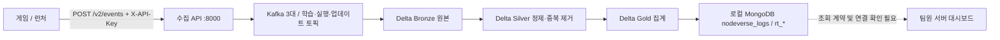

# v2 연동 현황과 정리 기준 (2026-11-20)

## 기준과 출처

이 폴더는 11월 16일 구현된 별도 파이프라인 v2이며, NVG의 기존 pipeline과 동일하지 않다.
게임 파트 구현결과서(2026-11-16)는 junbum8398-blip/nodeverse-game의
70daeaa, 1d43e5c 반영을 보고한다. 이는 보고서의 주장으로, 현재 원격 코드와 EXE를 재검증한 결과가 아니다.
게임 수정·병합 전 담당자에게 **최신 게임 저장소/브랜치/커밋/EXE와 병합 대상**을 확인한다.
기존 NVG 게임은 오래된 버전으로 취급한다. 이 문서는 게임 코드 변경 지시가 아니다.

## 현재와 이전 구조

| 구분 | 이전 NVG | 현재 v2 |
|---|---|---|
| 수집 | /v1/events, /v2/play-records | /v2/events; /v1/events는 실행 이벤트만 |
| 정제·저장 | Spark → MongoDB + direct_outbox | Spark → Delta Bronze/Silver/Gold → rt_* |
| 원격 서버 | .167의 회원·관계형 플레이 기록 직접 적재 | 현재 compose에 MySQL/direct-writer 없음 |
| 조회 | :8010/incoming, /overview | 이 폴더에는 해당 웹 대시보드 없음 |
| 회원 | MySQL 회원 UUID와 MongoDB 참조 연결 | player_id 수집만으로 회원 연결이 보장되지 않음 |

이전 direct-writer를 v2 이벤트에 그대로 연결하지 않는다. rt_*는 집계 구조이고
기존 game_sessions/problem_runs/solution_attempts/gameplay_events는 개별 기록 구조다.
대시보드가 어느 구조를 읽는지 확인한 후 조회 변경 또는 별도 변환기를 설계한다.
예약 토픽 nv.bundle.v2는 현재 생산·소비 계약이 없어 연결 경로로 간주하지 않는다.

## 게임과 파이프라인 공통 규칙

- 학습·업데이트 schema_version=2, 실행·exit_ 이벤트는 schema_version=1이다.
  같은 /v2/events 경로여도 모든 이벤트를 버전 2로 바꾸지 않는다.
- X-API-Key는 실제 .env의 INGEST_KEY와 일치해야 한다. 24자 이상 실제 임의 키를 사용한다.
  예제 replace-* 문자열을 운영 키로 쓰지 않고 채팅·Git·보고서에 실제 값을 남기지 않는다.
- HTTP 202는 Kafka 접수 확인이다. Delta/MongoDB 저장 및 화면 반영 완료가 아니다.
- 재전송은 동일 event_id와 본문을 유지한다. 같은 ID의 변경 본문은 Silver 격리 대상이다.
- 401은 설정/키 확인 후 재처리 여부를 판단하고, 422는 reason을 확인한다.
  게임 보고서상 두 응답은 rejected로 이동하므로 자동 복구된다고 가정하지 않는다.
- 발생 시각은 UTC 밀리초, 5분 초과 미래 및 6일 초과 과거 이벤트는 거절한다.
  6일 초과 오프라인 큐 보관/만료 UX는 게임 담당자 확인이 필요하다.
- 런처 환경변수 NODEVERSE_PLAYER_ID/RUN_ID/EXIT_MARKER와 게임의 수신 규칙을 함께 시험한다.
  설치 UUID를 회원 UUID로 간주하지 않는다. 로그인 회원 매핑은 서버 담당자와 확정한다.
- 매니페스트 GET /api/game/manifest?channel=windows-stable은 서버 담당 기능이다.
  현재 수집 API에는 없으며, 수집 주소와 매니페스트 서버 주소를 혼동하지 않는다.
- 정상 종료 마커 없는 종료는 원인 불명으로 취급한다. 강제 종료/충돌을 임의 확정하지 않는다.

## 실행과 점검 순서

1. Docker Desktop의 Linux 엔진을 실행한다. 기존 다른 compose 프로젝트와 8000/27017 충돌을 확인한다.
2. .env는 보존하고 .env.example과 비교하여 키와 COLLECTOR_BIND/MONGO_BIND를 설정한다.
   다른 PC 접속 시 필요한 바인딩과 방화벽 허용 대상을 담당자와 확정한다. MongoDB 무인증 전체 공개는 피한다.
3. python build_compose.py 후 docker compose -f compose.json config --quiet로 구성을 검사한다.
4. docker compose -f compose.json up -d --build로 시작한다. 볼륨과 체크포인트를 삭제하지 않는다.
5. python check.py로 설정·API·Kafka 준비 상태·인증 거절·Docker를 사전 점검한다.
   이 도구는 시험 이벤트를 전송하지 않고 키 값도 출력하지 않는다. 최종 저장 검증 도구는 아니다.
6. README의 simulator checks/smoke, verify counts/lag와 지연 측정을 실행한다.
7. 최신 실제 EXE로 1회 플레이·오프라인 복구·정상/비정상 종료·업데이트 폴백을 시험한다.
8. 같은 session_id/event_id를 따라 Kafka → Delta → MongoDB → 팀원 화면까지 대조한다.

## 남은 일과 완료 기준

| 우선순위 | 남은 일 | 완료 근거 |
|---|---|---|
| P0 | 최신 게임·서버 소스와 실제 수집/매니페스트 주소 확정 | 담당자 확인 + 빌드/커밋 기록 |
| P0 | 회원 ID 연결과 대시보드 조회 구조 확정 | 테스트 회원과 이벤트가 동일 사용자로 표시 |
| P0 | 이 PC에서 실제 전체 스택 시험 | Kafka/Delta/Mongo 건수 대조, 재전송·격리·복구 증빙 |
| P1 | 실제 게임 PC와 서버 PC를 연결한 통합 시험 | 동일 세션의 저장·화면 표시 확인 |
| P1 | 반영 지연과 10분 부하 재측정 | 측정 환경/유입량/지연/누락 수 기록 |
| P1 | 키 배포·백업/복원·접근 제한 | 비밀값 제외 운영 절차와 복구 결과 |
| P2 | itch.io 배포와 설치별 토큰 | 배포/인증 계약 확정 후 검증 |

게임 보고서의 자동 테스트 160건 및 README의 클라우드 시험은 기존 보고 결과다.
현재 PC의 통합 시험 완료로 대체하지 않는다.

11월 20일 로컬 점검 결과:
- 별도 .venv에 requirements.txt 설치 후 기존 단위 테스트 30건 통과(외부 의존성 경고 1건).
- pytest.ini로 _backup의 옛 테스트를 수집 대상에서 제외했다.
- docker compose -f compose.json config --quiet 통과.
- 처음에는 Docker 엔진에 연결되지 않았고, 재점검 중 엔진과 기존 컨테이너가 기동되었다.
- 기존 pipeline-gateway가 .81:8000 및 127.0.0.1:8000을 점유한다.
  nodeverse-dev의 Kafka/Mongo 컨테이너도 함께 존재한다. 새 collector를 같은 포트로 기동하지 않는다.
- 사전 점검 당시 API live/ready 및 인증 검사는 실패했다. 실제 키 값은 출력하지 않았다.
- 구형 서비스는 중지·삭제하지 않았으며, 신규 v2 전체 스택과 실제 EXE 통합 시험은 미완료다.
  구형 유지 여부와 v2 수집 포트/전환 시점을 정한 후 기동한다.

## Git와 보존

현재 저장소는 원격/dev 없이 main만 있는 상태에서 시작했다. 정리는 별도 feature 브랜치에 둔다.
미등록 구현결과서 v1.4 PDF, _backup, .env, 데이터 볼륨은 수정·삭제하지 않는다.
원격 연결/병합은 대상 저장소와 최신 버전을 확인한 뒤 진행한다. PDF에 적힌 완료 표시는
문서 작성 당시 기준이므로 이후 검증 기록과 구분한다.

### 후속 기술 점검 반영

위 최초 점검 이후 실제 별도 v2 스택을 기동하여 수집/저장/복구 시험을 진행했다.
현재 실행 검증 상태는 [5개 기술 항목 점검](TECHNICAL_REVIEW.md)을 기준으로 확인한다.
초기 “전체 스택 미완료” 기록은 당시 상태이며, 이후 엔진 단위 시험과 구분한다.
실제 게임 EXE와 팀원 대시보드까지의 통합은 여전히 별도 확인 대상이다.
