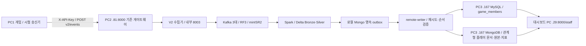

# V2 원격 DB 자동 적재 — 구축·시험 결과

검증일: 2026-11-20. 실제 실행 소스는 `outputs/NVG-v2-remote-sink`의 `feature/codex-v2-remote-sink` 브랜치입니다. Desktop의 기존 검토용 스택과 별도입니다. 게임 파일은 변경하지 않았습니다.

## 구성



기존 원인은 공개 8000에 V2 경로가 없고, 검토용 V2는 로컬 DB만 저장하던 구성이었습니다. 기존 V1 경로를 유지하고 V2 전용 전달 경로와 원격 적재 작업자를 추가했습니다. 새 live 볼륨을 사용하므로 기존 검토용 데이터나 과거 로그를 자동 재적재하지 않습니다.

## 사용 주소와 완료 판단

- 게임 송신: `http://192.168.0.81:8000/v2/events`에 **POST**, 기존 게이트웨이 키를 `X-API-Key` 헤더로 전달합니다. 브라우저 주소창의 GET은 전송 시험이 아닙니다.
- 수신 상태: `GET http://192.168.0.81:8000/v2/events/{event_id}`. 동일 헤더 필요. `202`는 수집 접수이며 원격 저장 완료를 뜻하지 않습니다. `stored`와 result의 scope를 확인합니다.
- 대시보드: `http://192.168.0.29:8000/staff/` (관리자 로그인 필요).
- 학습 이벤트는 `dashboard_records`, 업데이트·런타임은 별도 원본 archive가 저장 범위입니다. 후자를 가짜 플레이 기록으로 만들지 않습니다.

## 실측 시험 결과

공개 8000 경로로 스택(ST03) 문제 2세트, 학습 이벤트 18개를 전송했습니다. 각 세트의 전송 순서를 섞고 같은 9개를 재전송했습니다. 최신 게임 EXE나 물리적 PC1을 실행한 시험은 아닙니다.

| 검증 | 결과 |
|---|---|
| MySQL 시험 회원 | 1명 생성, 기존 회원 유지 |
| 원격 Mongo 플레이 문서 | 세션 2, 문제 정의 1, 문제 실행 2, 풀이 시도 4, 행동 이벤트 18 |
| 종료 결과 | 문제 해결 2, 시도 성공 2 / 실패 2 |
| 회원·참조·시간 | MySQL CHAR(32) ↔ Mongo 하이픈 UUID 일치, 참조 관계 유효, UTC BSON Date 확인 |
| 중복 재전송 | 행동 이벤트 18개 유지 |
| 기타 로그 | 업데이트 1, 런타임 2 원본 저장 |
| outbox | 고유 이벤트 21개 모두 stored |
| 지표 복제 | rt_minigame_1m 2, rt_alerts 9, rt_updates 1, rt_versions 2, rt_summary 1 — 로컬/원격 건수 일치 |
| 강제 종료 복구 | 적재 작업자 강제 종료 중 202 접수, 재시작 후 46.7초 안에 저장 |
| 자체 검사 | V2 42개 + 게이트웨이 브리지 3개 통과 |
| 실제 화면 | 시험 회원의 해결 2건·재시도 2건·행동 로그 18건 확인 |

시험 회원 이름은 `[연동시험] V2 자동 적재`, UUID는 `e328c572-1d84-528f-8ad2-0d9aaf3d84ad`입니다. 검증 JSON/전송 fixture는 로컬 `pipeline-v2/results/`에 보관하며 Git에는 포함하지 않습니다.

첫 시험에서 문제 코드를 `ST03:L1`로 저장하자 대시보드 분류가 되지 않았습니다. 코드는 `ST03`, 단계는 실행 문서의 level로 분리했습니다. 우리 시험용 문제 정의만 수정하고 기존 참조 UUID를 유지했습니다. 초기 작업자 재생성 시 남은 lease 문제는 45초 lease·10초 heartbeat·정상 종료 해제로 보완했고 강제 종료 복구를 재검증했습니다.

## 적재 규칙과 남은 제한

1. 기존 회원 UUID 또는 정확한 `game:member:<원본ID>`로 회원을 찾습니다. 설치 UUID만 보내는 신규 게임은 기존 회원과 자동 연결되지 않을 수 있습니다. 운영자가 확인한 비공개 회원 매핑이 필요하며, 미확인 회원을 임의 생성·연결하지 않습니다. 이 경우 원본은 보존하고 `waiting_context/member_mapping_required`로 대기합니다.
2. 원본 session_id와 회원·게임별 결정적 UUID로 대시보드 세션을 구성합니다. run_id와 attempt_id는 원본 UUID를 유지합니다. 문제 정의 UUID는 `(게임 코드, content_version)`에 고정되고 problem_runs.task_id는 이 정의 UUID를 참조합니다.
3. 세션 sequence는 1부터 연속이어야 합니다. 앞선 이벤트가 없으면 sequence_gap으로 기다립니다. 새 실행을 만들거나 누락된 원본을 동일 UUID로 재전송해야 합니다. 임의로 순서를 건너뛰지 않습니다.
4. 동일 ID의 내용 변경은 충돌 처리하고 기존 내용을 덮어쓰지 않습니다. outbox·원격 UUID·처리 영수증으로 재시도 시 수렴합니다. MySQL과 MongoDB 사이의 단일 분산 트랜잭션은 아니므로 중간 부분 저장은 가능하며 재시도로 완성합니다. 종단 전체의 절대적 exactly-once라고 표현하지 않습니다.
5. 명시된 시도·문제 종료만 반영합니다. 문제 해결을 게임 세션 종료로 추측하지 않습니다. 일시정지·실제 풀이 시간 규약이 없는 active_ms/paused_ms는 null이며 화면 평균 시간도 미집계입니다. hint_step 미전송 시 현재 팀원 화면에 `단계 None`이 보이므로 송신 규약 또는 화면의 결측 표시를 합의해야 합니다.
6. 24개 게임의 카탈로그 매핑은 포함하지만 전체 게임을 실행 검증한 것은 아닙니다. 이번 전 구간 검증은 ST03입니다. 최신 게임 저장소·브랜치·커밋·EXE의 기준을 팀원에게 먼저 확인한 후 게임 변경/병합과 나머지 게임 검증을 진행해야 합니다.

## 재실행·운영

비밀값은 `.env`, `.env.remote`, `.env.remote-context.json`, 기존 게이트웨이의 `.env.v2-bridge`에만 보관합니다. Docker 빌드 문맥에서 `.env*`는 제외합니다. 전달용 예제에는 실제 키·비밀번호를 넣지 않습니다.

```powershell
# pipeline-v2 폴더에서: 비공개 설정을 준비한 뒤
docker compose -p nodeverse-v2-live --env-file .env --env-file live.env -f compose.json --profile remote up -d --build
# 원격 DB를 실제로 쓰는 시험: 운영 데이터와 구분 가능한 시험 회원만 사용
python remote_live_test.py --allow-live-writes
# 적재 작업자에 한정된 강제 종료 복구 시험
python remote_recovery_smoke.py
```

게이트웨이는 `pipeline/compose.yaml`에 `compose.v2-bridge.yaml`을 추가하고 `V2_COLLECTOR_URL=http://nodeverse-v2-live-collector-1:8000`, 별도 내부 `V2_INGEST_KEY`를 비공개 파일로 설정합니다. 외부 바인딩은 현재 별도 `outputs/compose.lan.yaml`의 .81:8000 설정을 함께 사용합니다. 기본 수집기 8003과 로컬 Mongo 27020은 loopback 바인딩입니다. 기본 compose만 실행하면 remote 프로필은 시작되지 않습니다.

후속 우선순위: 최신 EXE 실제 PC1 시험 → 회원 UUID 연결 확정 → 종료·일시정지 시간 규약 확정 → 나머지 게임별 시나리오 검증 → 지연/처리량 부하 시험과 outbox 적체 알림 → 백업·복원 및 장시간 운영 검증.

## 2026-11-20 실플레이 감시 후 수정

현재 격리·재시도 정책과 실제 nb 적재 결과는 [LIVE_WATCH_FIXES_2026-11-20.md](LIVE_WATCH_FIXES_2026-11-20.md)를 우선 참고하세요. 이전의 ‘순서 대기’ 설명은 실제 누락 번호에는 계속 적용됩니다. 이제 도착한 잘못된 이벤트는 감사 가능한 격리 영수증을 기록하고 다음 연속 이벤트를 처리합니다. 기본 게임 파일은 변경하지 않았습니다.

새 PC 설정은 `remote/remote.env.example`을 `.env.remote`로 복사하고 비밀값을 별도 주입합니다. `remote/context.example.json`을 `.env.remote-context.json`으로 복사하면 기본적으로 회원 매핑이 비어 있습니다. 확인된 원본 player_id만 members 키에 추가하며, 값은 `external_member_key`, `verified: true`, `create_if_missing: false`로 기존 회원을 연결합니다. 실제 개인별 매핑 파일은 커밋하지 않습니다.
