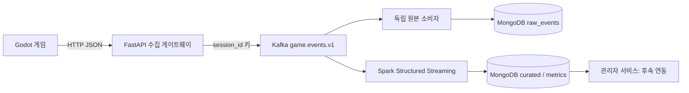

# NODEVERSE 로그 파이프라인 설계서

작성일: 2026-11-06 / 적용 범위: 로컬 단일 서버 MVP

## 1. 목적과 경계
게임이 플레이를 계속하는 동안 행동 로그를 수집하고 관리자 서비스가 읽을 원본 및 정제 데이터를 만든다. 관리자 인증·대시보드·AI 진단은 범위 밖이다. 기존 게임 씬은 수정하지 않는다.

## 2. 구성과 로컬 배치
Docker Compose로 Kafka 3.9.0 KRaft 단일 브로커, MongoDB 7.0.16, Python 수집 API·원본 소비자, Spark 3.5.3 local[2]를 실행한다. 권장 시작 자원은 CPU 4코어·메모리 8GB 이상이며 실측 용량 산정은 별도다. 외부 공개 포트는 localhost:8000뿐이다. Kafka·MongoDB는 내부 네트워크에 둔다. 서버를 다른 PC에서 사용할 때는 TLS 역방향 프록시와 접속 정책을 추가해야 한다.

## 3. 수집 계약
POST /v1/events, Content-Type: application/json, X-API-Key 헤더. OpenAPI는 /docs에서 확인한다.
필수 필드: event_id(UUID), player_id(가명 식별자), session_id, problem_id, attempt_id, event_type, occurred_at(시간대 포함 ISO8601), sequence(0 이상). schema_version=1, duration_ms=0이 기본값이다.
이벤트 종류: problem_started, attempt_started, operation, attempt_failed, hint_used, attempt_succeeded. sequence는 클라이언트 세션 내 증가 번호다. 수신 시간 received_at은 서버에서 추가한다. 5분 초과 미래 시각은 거부한다.
202는 Kafka 브로커 접수 확인이며 MongoDB 저장이나 분석 완료를 의미하지 않는다. 401은 키 오류, 422는 규격 오류, 503은 재시도 대상이다. 네트워크 응답 유실도 가능하므로 게임은 같은 event_id로 재전송한다. 로컬 큐 보관·지수 백오프·게임 UI와 분리한 비동기 전송은 게임 담당자와 연동할 계약이다. 키는 게임 실행파일에 넣으면 추출될 수 있으므로 사용자 인증을 대체하지 않는다.

## 4. 토픽과 보관
토픽 game.events.v1, 파티션 3, 복제 1, 보관 7일. session_id를 메시지 키로 사용해 같은 세션의 브로커 내 순서를 유지한다. 이벤트 시간 순서는 sequence와 occurred_at으로 재구성한다. 단일 브로커 ACK는 서버 디스크 유실을 견디는 고가용성 보장이 아니다.

## 5. 저장 모델과 멱등성
raw_events: _id=topic:partition:offset, payload=수신 이벤트 전체, partition, offset. 클라이언트 재전송도 원본으로 보존한다. 저장 성공 뒤 동기 offset commit을 수행한다.
curated: _id=event_id. 동일 ID 재전송은 한 건으로 유지된다. session_id/problem_id/attempt_id/sequence 복합 인덱스를 만든다. 동일 ID의 다른 payload는 마지막 수신 값으로 대체하므로 클라이언트는 ID와 내용을 불변으로 유지해야 한다.
metrics: _id={player_id,problem_id}; events, failures, successes, hints. 실패·성공·힌트 이벤트의 개수이며 세션 이탈이나 인과 진단은 아니다.

## 6. 처리와 복구
Spark는 Kafka를 earliest에서 시작하고 이후 영속 checkpoint를 따른다. 배치는 5초 간격이며 foreachBatch에서 curated upsert 후 전체 집계를 갱신한다. 중간 장애 시 배치 재실행으로 같은 최종 결과를 만든다. 원본 소비자는 별도 consumer group이므로 Spark 장애와 독립적이다. 영속 볼륨은 Kafka·MongoDB·checkpoint에 각각 둔다.
운영 지표: API 401/422/503 비율, Kafka 소비 지연, 원본/정제 건수, Spark 배치 시간, 디스크 잔량. 로그 확인 명령은 README 참조. 현재 잘못된 Kafka 직접 입력은 Spark 배치를 실패시키므로 Kafka 쓰기 경로를 게이트웨이로 제한한다. 운영 전 격리 토픽·경보를 추가한다.

## 7. 목표 그림과 MVP 차이
원본 Kafka Connect/MongoDB Sink 대신 Python 독립 소비자를 사용한다. Spark MongoDB Connector 대신 foreachBatch+PyMongo로 저장한다. 현재 수치 집계는 Spark 배치가 MongoDB aggregation을 호출한다. 대용량 목표 구성에서는 Spark 분산 정제·집계와 MongoDB Connector로 전환한다. 현재 드라이버 순차 upsert와 전체 집계는 소규모 로컬 검증용이다.
세션·시도별 타임라인은 curated에서 식별자와 sequence로 조회할 수 있지만 완성된 시도 요약, 시간 기반 이탈 판정, 기간 집계, 원본 재분석 명령은 후속 개발 항목이다. 운영용 완성본으로 간주하지 않는다.

## 8. 검증 기준
smoke.py: 인증 실패 401, 잘못된 필드 422, 정상 및 중복 접수 202, 원본 2건·정제 1건·실패 지표 1 검증. 재시작 후 checkpoint/offset 보존과 실제 Godot 비동기 큐 연동은 사용자 환경 인수 테스트에 포함한다.

## 9. 참고
- Spark Kafka 공식 연동: https://spark.apache.org/docs/3.5.3/structured-streaming-kafka-integration.html
- MongoDB Spark Connector: https://www.mongodb.com/docs/spark-connector/v10.x/
