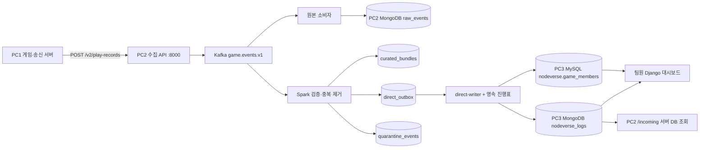

# NODEVERSE 전체 PC 공유용 작업 보고서·운영 지침

- 작성일: **2026-11-09 (한국시간)**
- 기준: 오늘 작업 결과와 최종 자동 적재 구성
- 공유 대상: 게임/송신 담당, 수집·정제 담당, DB 담당, 대시보드 담당
- 실제 비밀번호·접속 키·Django 비밀키는 이 문서에 포함하지 않음

> **핵심:** PC1이 새 관계 레코드 규격으로 PC2에 보내면, PC2의 Kafka·Spark를 거쳐 PC3 DB에 자동 적재됩니다. PC3에 별도 HTTP 수신 API를 두는 방식은 사용하지 않습니다. 단, PC2의 수집 API는 필요합니다.
>
> **검증 범위:** PC2에서 PC1 역할을 모의하여 실제 PC3 저장까지 시험했습니다. 별도 물리 PC1 송신은 아직 남아 있습니다. 팀원이 대상 대시보드 표시 완료를 확인했습니다.

## 1. PC별 역할과 주소

| 구분 | 주소 | 역할 | 실행 환경 |
|---|---|---|---|
| PC1 | 송신 PC 주소 미확정 | 게임 서버에서 로그인 검증, 회원·플레이 컨텍스트를 포함한 데이터 송신 | 팀원 환경 |
| PC2 | **192.168.0.81** | 수집 API, Kafka, Spark, 원본·정제 저장, 자동 적재기, 점검 화면 | Windows + Docker |
| PC3 | **192.168.0.167** | MySQL 회원정보 및 MongoDB 플레이 기록 저장 | Windows 직접 설치, Docker 불필요 |
| 대시보드 PC | **192.168.0.29** | PC3 DB를 조회하는 Django 대시보드 | 팀원 담당 |

대시보드의 외부 접속 포트·URL은 이 문서에서 확정하지 않습니다. 문서에 나온 localhost 주소를 다른 PC에서 사용하면 안 됩니다.

## 2. 최종 아키텍처



- 이 문서의 Spark 정제는 구조·규약 검증과 중복 제거, 적재 가능한 관계 레코드 분리를 포함합니다.
- 없는 회원·문제·세션 정보를 임의로 생성하거나 잘못된 데이터를 자동 보정하지 않습니다.
- 회원 MySQL과 로그 MongoDB 사이의 분산 트랜잭션은 없습니다. 일부 저장 후 실패하면 같은 ID로 재시도합니다.

## 3. 오늘 완료한 작업

1. MongoDB·Kafka 중지로 기존 점검 화면이 열리지 않던 문제 복구.
2. 당시 MongoDB·Kafka 컨테이너에 `unless-stopped` 재시작 정책 적용.
3. 수집·저장 경로 재점검 및 더미 요청 240건 검증.
4. `X-API-Key` 인증 확인. Bearer 인증과 구분하여 팀원 연결 방법 안내.
5. `/incoming` 팀원 직접 전송 로그 검색·자동 갱신·격리 상태 조회 추가.
6. 전달 PDF를 분석하고 Django Bearer 방식 연동 클라이언트를 준비했으나, 이후 합의에 따라 직접 DB 적재 방식 채택. 해당 HTTP 클라이언트는 현재 실시간 경로에 사용하지 않음.
7. 직접 적재기: 회원 UUID, 관계·시간·중복 검증, 재개 진행표 구현.
8. 독립 MySQL 8.4·MongoDB 8.0 테스트 환경에서 직접 적재 검증 통과.
9. PC3 실제 MongoDB 8.0.34 접속 및 5개 컬렉션·인덱스 확인.
10. PC3 MySQL 8.4.13 전용 계정 인증·game_members 권한 확인.
11. 실제 PC3에 수동 적재 경로로 테스트 회원·플레이 1세트 저장 확인.
12. `/incoming`에서 PC3 MongoDB를 읽기 전용으로 조회하는 기능 추가.
13. `/v2/play-records` → Kafka → Spark → 영속 outbox → PC3 자동 적재 연결.
14. 자동 저장·중복 방지·내용 충돌 격리·서버 DB 조회 및 팀원 대시보드 표시 확인.

## 4. 주소와 포트 안내

| 목적 | 주소 | 사용 방법 |
|---|---|---|
| 새 자동 적재 요청 | `http://192.168.0.81:8000/v2/play-records` | POST, 아래 헤더와 JSON 필요 |
| 자동 적재 상태 | `http://192.168.0.81:8000/v2/play-records/{event_id}` | GET, 같은 헤더 필요 |
| 기존 단일 행동 로그 | `http://192.168.0.81:8000/v1/events` | POST, 기존 로컬 분석 경로 유지 |
| API 규격 확인 | `http://192.168.0.81:8000/docs` | 브라우저 |
| 수신·서버 DB 조회 | `http://192.168.0.81:8010/incoming` | 브라우저, 키 입력 |
| 더미 생성 실험실 | `http://192.168.0.81:8010/` | 브라우저, 실험 배치 중심 |
| 그래프 요약 | `http://192.168.0.81:8010/overview` | 브라우저, 더미 실험 결과 중심 |
| PC3 MySQL | `192.168.0.167:3306` / `nodeverse` | 적재 프로그램만 직접 연결 |
| PC3 MongoDB | `mongodb://192.168.0.167:27017/` / `nodeverse_logs` | 적재·조회 프로그램 연결 |

**8000은 수집 API, 8010은 조회·점검 화면입니다.** POST 주소를 브라우저 주소창으로 열면 GET 요청이 되어 405가 나올 수 있습니다.

### 인증을 혼동하지 않기

- PC1 → PC2: 헤더 `X-API-Key: <PC2에서 별도 공유한 INGEST_KEY>`.
- PC2 → PC3 MySQL: 별도 적재 DB 계정·비밀번호.
- PC2 → PC3 MongoDB: 현재 내부망 시험은 인증 비활성화 상태. 서버 담당자는 방화벽 접근 제한 정책을 적용·확인해야 함.
- 과거 PDF의 `GAME_SERVER_API_KEY` Bearer 인증은 Django 수신 API용으로, 현재 직접 DB 적재 경로에는 사용하지 않음.
- 키·비밀번호를 URL, JSON 본문, Git, 공유 문서에 넣지 않음.

## 5. PC1 담당자: 무엇을 보내야 하나요?

### 중요한 변경

**PC3 자동 적재에는 `/v2/play-records`를 사용합니다.** 기존 `/v1/events`는 회원·문제·세션 관계 정보가 부족하므로 PC3에 자동 적재하지 않습니다. 기존 API를 호출하는 게임은 송신 규격 변경이 필요합니다.

요청 헤더:

```text
Content-Type: application/json
X-API-Key: <별도 전달받은 키>
```

본문의 최상위 구조:

```json
{
  "schema_version": 1,
  "event_type": "relational_bundle",
  "event_id": "<전송 묶음의 UUID>",
  "manifest": ["회원·문제·세션·실행·시도·이벤트 기록 객체"]
}
```

위 코드는 구조 설명용입니다. `manifest` 안의 문자열은 실제로 기록 객체로 작성해야 합니다. 전체 전송 예제는 13절에 있습니다.

### 필수 규칙

1. 게임 서버가 로그인 검증을 완료한 회원만 실데이터로 전달합니다. 샘플은 로그인 검증을 대신하지 않습니다.
2. 회원 원본 ID는 변경되지 않는 값으로 유지합니다.
3. 문제 `(task_id, content_version)`별 UUID를 고정합니다.
4. 세션·실행·시도·이벤트는 UUID를 사용합니다. 문제실행의 `task_id`는 문제 코드가 아니라 문제 정의 UUID입니다.
5. 회원 응답 대신 직접 적재기에서 회원을 연결하도록 예제의 세션 `player_id`에는 `$player_id`를 사용합니다. 적재기가 외부 키로 회원을 찾고 대시보드 UUID로 대체합니다.
6. 순서 값은 1 이상이며 세션 내에서 중복되지 않아야 합니다.
7. 시각에는 시간대가 있어야 합니다. 수신 후 UTC BSON Date로 저장됩니다.
8. 재시도에는 전송 묶음 ID와 내부 UUID·sequence·시각·본문을 모두 유지합니다.
9. 같은 ID의 다른 내용은 덮어쓰지 않고 격리 또는 차단합니다.
10. 후속 요청이 이전 기록을 참조하면 이전 요청의 `stored` 상태를 확인하고 보냅니다.
11. 비밀번호·토큰·관리자 코드 등 민감 필드를 보내지 않습니다.
12. 현재 허용된 자동 적재 행동 유형은 `operation_succeeded`, `operation_failed`, `hint`입니다. 나머지는 매핑 합의가 필요합니다.

### 전송 및 완료 확인 예시

```powershell
$env:INGEST_KEY = '<별도 전달받은 키>'
Invoke-RestMethod -Uri 'http://192.168.0.81:8000/v2/play-records' `
  -Method Post -Headers @{'X-API-Key'=$env:INGEST_KEY} `
  -ContentType 'application/json; charset=utf-8' -InFile '.\sender-payload.json'

# event_id에는 최상위 전송 묶음 UUID를 사용합니다.
Invoke-RestMethod -Uri 'http://192.168.0.81:8000/v2/play-records/<event_id>' `
  -Headers @{'X-API-Key'=$env:INGEST_KEY}
```

| 응답/상태 | 의미·조치 |
|---|---|
| HTTP 202 | Kafka 접수 성공. 아직 PC3 적재 완료는 아님 |
| not_staged | 미접수 또는 Spark 대기. 이 값만으로 접수 실패를 단정하지 않음 |
| pending / processing | 영속 대기열에 있으며 원격 적재 대기 또는 처리 중 |
| stored | PC3 DB 쓰기 완료 |
| blocked | 구조·참조·상태 설정 등 확인 필요. 같은 내용으로 반복 전송만 하지 말고 담당자 확인 |
| HTTP 401 | 키·헤더 확인. Authorization/Bearer가 아닌 X-API-Key 사용 |
| HTTP 422 | 요청 필수 필드·UUID·길이·형식 확인 |
| 통신 실패 / HTTP 503 | 같은 ID·같은 본문으로 재시도 |

## 6. PC2 담당자: 실행과 점검

저장소 기준 작업 폴더는 `NVG/pipeline`입니다. PC마다 체크아웃 위치는 달라도 됩니다.

### 비밀 설정

- `pipeline/.env`: 수집 키, 로컬 DB, 조회 대상 설정.
- `pipeline/direct/.env`: PC3 DB 접속 계정과 상태 정책.
- 실제 파일은 Git·Docker 이미지에서 제외합니다. 신규 설치 때 예제 파일을 복사하되 기존 비밀 파일을 덮어쓰지 않습니다.
- `DIRECT_MYSQL_HOST=192.168.0.167`, DB `nodeverse`.
- `DIRECT_MONGO_URI=mongodb://192.168.0.167:27017/`, DB `nodeverse_logs`.
- PC3 조회 화면은 `VIEW_MONGO_URI`, `VIEW_MONGO_DATABASE`를 사용합니다.

### 기본 실행

```powershell
# pipeline 폴더에서. 기본 공개 범위는 localhost입니다.
docker compose --profile lab --profile direct up -d --build
```

LAN 공개 시 현재 PC의 로컬 실행 설정도 유지해야 합니다. 재현 예시는 아래와 같습니다. 이미 같은 설정 파일이 있으면 덮어쓰지 말고 비교합니다.

`compose.lan.yaml`:

```yaml
services:
  gateway:
    ports: !override
      - '127.0.0.1:8000:8000'
      - '192.168.0.81:8000:8000'
```

```powershell
$env:LAB_BIND_IP = '192.168.0.81'
docker compose -f compose.yaml -f compose.lan.yaml --profile lab --profile direct up -d --build
```

`!override`를 지원하는 Docker Compose 버전이 필요합니다. PC IP가 바뀌면 이 설정과 송신 주소를 함께 변경합니다.

### 서비스와 영속 데이터

| 구성 | 역할 | 보존할 데이터 |
|---|---|---|
| gateway | PC1 요청 검증·Kafka 접수 | 실행 설정 |
| kafka | 수집·처리 버퍼 | kafka-data |
| raw-worker | 수신 원본 보존 | 로컬 MongoDB raw_events |
| spark | 규격·중복 검증, outbox 생성 | checkpoints |
| direct-writer | PC3 적재·재시도 | direct-journals 및 로컬 direct_outbox |
| mongo | 로컬 원본·정제·대기열 | mongo-data |
| lab | 조회·테스트 화면 | 로컬 DB의 실험 이력 |

```powershell
docker compose --profile lab --profile direct ps -a
docker compose logs --tail 50 gateway spark direct-writer
docker compose logs --tail 50 raw-worker mongo kafka lab
```

규격/처리 코드 변경 후에는 이미지 재빌드와 Spark 재시작이 필요합니다. Python 모듈이 이미 로드된 Spark는 파일만 바뀌어도 이전 규칙을 계속 사용할 수 있습니다.

오늘 복구 때 기존 Kafka·MongoDB 컨테이너에 자동 재시작 정책을 적용했습니다. 현재 Compose 원본은 이 두 서비스에 재시작 정책을 명시하지 않으므로 컨테이너 재생성 시 정책을 재확인해야 합니다.

```powershell
# 필요한 경우 현재 컨테이너에 적용
docker update --restart unless-stopped pipeline-mongo-1 pipeline-kafka-1
```

### 장애 대응

- PC3 DB 장애: 원본·outbox를 유지하고 writer가 재시도합니다.
- blocked: 참조·매핑·시작 상태·충돌 원인을 조사합니다. 기존 문서를 자동 덮어쓰지 않습니다.
- SQLite 진행표와 outbox를 지우고 다시 시작하지 않습니다.
- writer는 한 개만 실행합니다. 같은 세션을 다른 적재기/수신 API와 동시에 수정하지 않도록 조율합니다.
- `down -v`, 컬렉션 삭제, 진행표 삭제는 일반 재시작 방법이 아닙니다.
- DB 전체 재시작·강제 종료로 원격 장애를 고의 발생시키는 시험은 오늘 수행하지 않았습니다.

## 7. PC3 담당자: 저장 규칙과 확인

### 대상과 권한

- MySQL: `nodeverse.game_members`만 적재. SELECT/INSERT/UPDATE.
- MongoDB: `nodeverse_logs`의 아래 5개 컬렉션.
- 관리자 계정·권한·Django 내부 테이블은 수정하지 않음.
- 적재 계정과 조회 계정을 분리해 운영.
- MongoDB는 현재 내부망 시험을 위한 무인증 구성. 방화벽 제한은 서버 담당자가 직접 적용·검증. 일반 인터넷에 공개하지 않음.

| 저장소 | 주요 연결 규칙 |
|---|---|
| game_members | external_member_key=`game:member:<원본ID>`; 회원 UUID는 CHAR(32) |
| game_sessions | player_id는 같은 회원 UUID의 하이픈 포함 문자열 |
| game_problems | task_id(문제 코드)+content_version별 UUID 고정 |
| problem_runs | session_id → 세션, task_id → 문제 정의 UUID |
| solution_attempts | run_id → 문제 실행, (run_id, number) 고유 |
| gameplay_events | session/run/attempt 참조, (session_id, sequence) 고유 |

MongoDB 시각은 UTC BSON Date, 시간 단위는 밀리초입니다. UUID·순서·본문을 재시도마다 바꾸지 않습니다. MySQL 회원 외부 키는 대소문자만 다른 식별자를 발급하지 않습니다.

### 이번 자동 적재 테스트 식별자

- 회원 이름: **자동 적재 테스트**
- 회원 UUID(CHAR32): `52b87d7867eb4366bad590bd97df80fe`
- 세션 UUID: `2e49dd0e-b879-40e6-a544-8f39e42a4a66`
- 행동 이벤트 UUID: `e981013c-4104-4cc2-b72b-37fb13702001`
- 최상위 전송 묶음 UUID: `76b8b44f-3887-4ba6-9959-6a36d13d9e54`

이들은 실제 사용자 데이터가 아닌 시험용 식별자입니다. 시험 데이터도 현재 `data_source=live`로 적재되므로 이름·외부 회원 ID의 테스트 접두어로 구분해야 합니다. 삭제는 별도 합의 전 수행하지 않습니다.

## 8. 대시보드 담당자: 조회 방법

PC2 점검 화면:

1. `http://192.168.0.81:8010/incoming` 접속.
2. 조회 대상에서 **팀원 서버 DB (192.168.0.167)** 선택.
3. PC2 수집 키 입력 후 연결·검색.
4. 검색 조건을 비우면 서버의 gameplay_events를 최신 수신 순으로 조회.
5. 특정 검증은 위 세션 또는 이벤트 UUID로 검색.

- 이 화면은 MongoDB를 읽기만 하며 복사/전송을 수행하지 않습니다.
- 회원 이름은 MySQL에서 조회하지 않으므로 UUID로 표시합니다.
- 서버 모드에서 ‘정제 완료’는 이벤트와 참조 관계가 존재함을 뜻하며 로컬 Kafka 처리 여부를 판정하는 값은 아닙니다.
- 서버 모드의 더미 포함 체크박스는 적용되지 않습니다.
- 로컬 수신 로그 모드와 서버 DB 모드는 서로 다른 저장소입니다.
- 그래프 요약 `/overview`는 현재 더미 실험 배치 중심입니다. 서버 전체 데이터 그래프와 동일하지 않습니다.
- 상대 Django 대시보드에서는 회원·세션·행동 로그·지표를 확인합니다. 해당 화면 접근 권한/주소는 대시보드 담당자가 전달합니다.

## 9. 오늘 검증 결과

| 검사 | 결과 |
|---|---|
| MongoDB 접속 | PC3 8.0.34, 대상 5개 컬렉션·필수 인덱스 확인 |
| MySQL 접속 | PC3 8.4.13, 적재 전용 계정과 회원 테이블 권한 확인 |
| 기존 로컬 경로 | 단일 이벤트·종료·중복·격리·오프라인 큐 테스트 통과 |
| 자동 적재 | HTTP 202 → Kafka → Spark → outbox → PC3 stored 확인 |
| 처리 시간 | 이번 단일 시험에서 약 6초. 성능 SLA가 아님 |
| 원격 데이터 | 회원 1명, 문제·세션·실행·시도·이벤트 연결 확인 |
| 중복/내용 충돌 | 원본 3건, 정제 묶음 1건, 적재 작업 1건, 충돌 격리 1건 |
| 원격 조회 | PC2 incoming에서 이벤트·관계 문서 조회 성공 |
| 대시보드 | 사용자가 팀원 화면 표시 완료 확인 |
| 별도 물리 PC1 송신 | 미검증. PC2에서 PC1 역할을 모의 |

회원정보나 관계가 맞지 않는 기존 데이터를 무조건 변환·이관한 시험은 아닙니다.

## 10. 남아 있는 합의와 인수 시험

1. **진행 중 상태값:** 이번 테스트는 `in_progress` 가정. 상대 애플리케이션의 정확한 enum 확인 필요.
2. **종료/시간:** 종료 갱신은 비활성화(`DIRECT_FINALIZATION_POLICY_CONFIRMED=0`). 실제 풀이·일시정지·재개 시간 규칙 확정 필요.
3. **필드 매핑:** 기존 단일 이벤트의 operation/성공 여부/hint 정보, topic, 문제 버전·제목, 세션·시도 UUID 매핑 확정 필요.
4. **PC1 실제 송신:** 새 규격 반영 후 별도 PC에서 POST, stored 및 PC3 대시보드 확인.
5. **운영 검증:** 인증·권한·계정 분리, 보관·삭제 정책, 원격 DB/네트워크 장애 및 복구 시험, 처리량·대기열 경보.
6. **상태 변경 동시성:** 현재 writer 1개 기준. 다중 writer와 다른 프로그램의 동시 수정은 별도 설계 필요.
7. **기존 데이터 이전:** 현재 7.0.16/nodeverse와 대상 8.0.34/nodeverse_logs는 모델·버전이 다름. 임시 DB 변환 검증 전 덮어쓰지 않음.

## 11. 코드 위치와 변경 이력

저장소: https://github.com/jobless-fish/NVG
최종 업로드 브랜치: `feature/codex-live-direct-sink`
최종 커밋: `b32fb63`

| 파일 | 역할 |
|---|---|
| pipeline/gateway.py | v1 수집 및 v2 관계 레코드 접수·상태 조회 |
| pipeline/bundle.py | 관계 묶음 규격 검증 |
| pipeline/processing.py | 정제·중복·충돌 격리·outbox 생성 |
| pipeline/stream.py | Kafka → Spark 처리 |
| pipeline/direct/worker.py | 영속 자동 적재 worker |
| pipeline/direct/loader.py | MySQL/MongoDB 검증·쓰기·재개 |
| pipeline/direct/LIVE.md | 자동 적재 세부 지침 |
| pipeline/direct/FIELD_MAPPING.md | 기존 source와 대상 필드 매핑안 |
| pipeline/incoming.py, incoming.html | 로컬/서버 데이터 조회 |
| pipeline/compose.yaml | Docker 실행 구성 |

오늘 커밋:

| 시각(KST) | 커밋 | 내용 |
|---|---|---|
| 10:06 | 894ffe0 | 직접 수신 데이터 조회 화면 |
| 11:07 | ab7fd64 | PDF 기반 서버 간 연동 준비 |
| 11:21 | 56514f0 | 직접 DB 적재기·독립 검증 |
| 12:24 | d1b1ee7 | 원격 서버 MongoDB 조회 |
| 12:32 | b32fb63 | Kafka/Spark → 원격 DB 자동 적재 |

브랜치 업로드와 원격 동기화 완료. PR 자동 생성은 인증 문제로 미완료이며 dev 병합 완료를 의미하지 않습니다. 브랜치에는 선행 미병합 변경이 포함되어 있습니다.

PR 생성: https://github.com/jobless-fish/NVG/compare/dev...feature/codex-live-direct-sink?expand=1

## 12. 오류 대응 빠른 안내

| 증상 | 확인할 것 |
|---|---|
| 화면 접속 거부 | Docker, MongoDB·Kafka·lab 실행, PC IP, 8010 방화벽 |
| API health 503 | Kafka 준비 상태·수집 API 로그 |
| 401 | PC2 X-API-Key 값·공백·Bearer 오사용 |
| MySQL 1045 | 계정명·비밀번호·접속 호스트 192.168.0.81 허용 |
| 202인데 데이터 안 보임 | v2 상태 조회, Spark·direct-writer·outbox |
| blocked | 규약/회원/참조/인덱스/상태 정책. 임의 덮어쓰기 금지 |
| 서버 DB 조회 503 | VIEW_MONGO_URI, PC3 방화벽·MongoDB 상태 |
| 화면의 조회 대상이 안 보임 | Ctrl+F5로 갱신 |
| 같은 ID 다른 내용 | 새 이벤트이면 새 UUID, 재시도이면 원래 내용 유지 |

## 13. 검증된 PC1 전송 예제

아래 JSON은 실제 시험에 사용한 식별자를 포함합니다. **그대로 재전송하면 기존 시험 데이터의 재시도**입니다. 새 플레이를 만들 때만 관계를 유지하며 새 회원/세션/실행/시도/이벤트 UUID와 시각을 생성합니다. 문제 코드·버전의 UUID는 고정해야 합니다. 아래 날짜를 현재 시간으로 바꾸면서 같은 ID를 재사용하면 충돌합니다.

```json
{
  "schema_version": 1,
  "event_type": "relational_bundle",
  "event_id": "76b8b44f-3887-4ba6-9959-6a36d13d9e54",
  "manifest": [
    {
      "path": "/api/game/player-login",
      "body": {
        "member_id": "stream-live-1e1b2b9bec",
        "display_name": "자동 적재 테스트"
      }
    },
    {
      "path": "/api/game/records",
      "body": {
        "record_type": "problem",
        "data": {
          "id": "e7637883-a541-52e1-bcdd-a1a6e87ad08c",
          "task_id": "stream-problem-1e1b2b9bec",
          "content_version": "integration-1",
          "title": "Stack pop test",
          "topic": "stack"
        }
      }
    },
    {
      "path": "/api/game/records",
      "body": {
        "record_type": "session",
        "data": {
          "id": "2e49dd0e-b879-40e6-a544-8f39e42a4a66",
          "player_id": "$player_id",
          "topic": "stack",
          "started_at": "2026-11-09T03:29:51.571721+00:00"
        }
      }
    },
    {
      "path": "/api/game/records",
      "body": {
        "record_type": "run",
        "data": {
          "id": "b12eb179-71e7-4d54-995b-e4289f259531",
          "session_id": "2e49dd0e-b879-40e6-a544-8f39e42a4a66",
          "task_id": "e7637883-a541-52e1-bcdd-a1a6e87ad08c",
          "started_at": "2026-11-09T03:29:51.571721+00:00"
        }
      }
    },
    {
      "path": "/api/game/records",
      "body": {
        "record_type": "attempt",
        "data": {
          "id": "d468dbfb-4267-4a85-bc00-6acc30a08209",
          "run_id": "b12eb179-71e7-4d54-995b-e4289f259531",
          "number": 1,
          "started_at": "2026-11-09T03:29:51.571721+00:00"
        }
      }
    },
    {
      "path": "/api/game/records",
      "body": {
        "record_type": "event",
        "data": {
          "id": "e981013c-4104-4cc2-b72b-37fb13702001",
          "session_id": "2e49dd0e-b879-40e6-a544-8f39e42a4a66",
          "run_id": "b12eb179-71e7-4d54-995b-e4289f259531",
          "attempt_id": "d468dbfb-4267-4a85-bc00-6acc30a08209",
          "sequence": 1,
          "event_type": "operation_succeeded",
          "operation": "pop",
          "occurred_at": "2026-11-09T03:29:51.571721+00:00",
          "state_before": {
            "size": 2
          },
          "state_after": {
            "size": 1
          },
          "payload": {}
        }
      }
    }
  ]
}
```

## 14. PC별 최종 체크리스트

### PC1
- [ ] v2 규격 구현, 로그인 검증과 회원 원본 ID 고정
- [ ] 키 별도 전달 수신
- [ ] 재시도 시 UUID·순서·본문 유지
- [ ] 실제 PC1에서 요청하고 stored 확인

### PC2
- [x] Kafka·Spark·영속 outbox·직접 적재기 연결
- [x] 실제 PC3 저장과 중복·충돌 확인
- [ ] 운영 상태·종료 정책 확정
- [ ] 큐·journal·checkpoint 백업과 장애 복구 시험

### PC3·대시보드
- [x] DB 계정·컬렉션·인덱스 및 시험 데이터 확인
- [x] 사용자에게서 대시보드 표시 확인 받음
- [ ] 방화벽 제한·조회 계정 권한 독립 확인
- [ ] 상태 enum·지표 계산·종료 규칙 확정
- [ ] 실제 PC1 송신 기록의 화면 확인

---
이 문서는 2026-11-09 작성 시점의 구성과 검증 범위를 기록합니다. 비밀 설정 파일은 별도 보관하며 공유 문서에 붙이지 않습니다.
